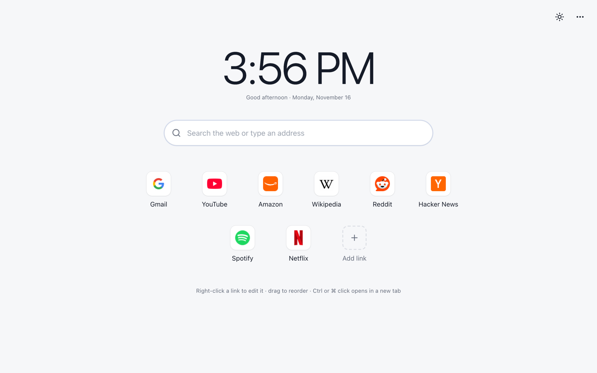

# Home - Clean New Tab

A clean new tab page for Chrome, Edge and Firefox: a big clock, a search box and your favourite sites one click away.

Most new tab extensions fill the page with news, ads and sign-ups, and send your data somewhere. Home does none of that. Your links are stored only in your browser, nothing is sent anywhere, and the page opens instantly.

## Install on Chrome

1. Download `Home.zip` from the [latest release](https://github.com/p32929/Home/releases/latest).
2. Unzip it. You get a folder called `Home`. Keep it somewhere it will stay, like your Documents folder.
3. Open `chrome://extensions` and turn on **Developer mode** (top right).
4. Click **Load unpacked** and pick the `Home` folder. Open a new tab and you are done.

## Update to a new version

1. Download the new `Home.zip` and unzip it over the same `Home` folder, replacing the old files.
2. On `chrome://extensions`, click the reload arrow on the Home card. Your links stay.

To be extra safe, use **Export links** first (see below). If you load the new version from a different folder, Chrome treats it as a new extension with no links, and **Import links** brings them back.

## Install on Edge

Same steps as Chrome, but open `edge://extensions` and turn on **Developer mode** (left side).

## Install on Firefox

1. Open `about:debugging#/runtime/this-firefox`.
2. Click **Load Temporary Add-on** and pick `manifest.json` inside the `Home` folder.

Firefox removes temporary add-ons when it closes, so this is good for trying it out.

## Use it

1. **Add a link:** click the **+ Add link** tile, or click the Home button in the toolbar on any page to add that page.
2. **Edit or delete:** right-click a link, or hover it and click the three dots.
3. **Reorder:** drag a link to a new place. Use the **⋯** menu (top right) to sort by name or by the ones you use most.
4. **Search:** type in the search box and press Enter. An address like `github.com` opens the site; anything else is searched with your browser's search engine.
5. **Theme:** the sun / moon button (top right) switches between light, dark and your system setting.
6. **Back up or move your links:** **⋯** menu, then **Export links** saves a file. **Import links** loads it on any computer.

Links you saved with the old version of Home are moved over by themselves the first time you open a new tab.

## Build it yourself

1. `npm install`
2. `npm run zip` builds the extension into `dist/` and makes `release/Home.zip`.
3. `npm run dev` runs the page in a normal browser tab while you work on it (links are then saved in that tab's local storage).

## License

MIT License — see [LICENSE](LICENSE) for the full text.

## Contributing

Contributions are very welcome, thank you! Before you start on a pull request, please open an issue and tell me what you would like to add or change. That way we can agree on it first, and your time is not wasted on something that might not fit. Thanks for helping make Home better.

## You might also like

<a href="https://openstore.pfay.workers.dev/cards/p32929/0?n=4&amp;repo=Home"><picture><source media="(prefers-color-scheme: dark)" srcset="https://openstore.pfay.workers.dev/cards/p32929/0.svg?n=4&amp;repo=Home&amp;theme=dark"></picture></a><a href="https://openstore.pfay.workers.dev/cards/p32929/1?n=4&amp;repo=Home"><picture><source media="(prefers-color-scheme: dark)" srcset="https://openstore.pfay.workers.dev/cards/p32929/1.svg?n=4&amp;repo=Home&amp;theme=dark"></picture></a> <a href="https://openstore.pfay.workers.dev/cards/p32929/2?n=4&amp;repo=Home"><picture><source media="(prefers-color-scheme: dark)" srcset="https://openstore.pfay.workers.dev/cards/p32929/2.svg?n=4&amp;repo=Home&amp;theme=dark"></picture></a><a href="https://openstore.pfay.workers.dev/cards/p32929/3?n=4&amp;repo=Home"><picture><source media="(prefers-color-scheme: dark)" srcset="https://openstore.pfay.workers.dev/cards/p32929/3.svg?n=4&amp;repo=Home&amp;theme=dark"></picture></a>

<a href="https://p32929.github.io/share/?repo=Home"><picture><source media="(prefers-color-scheme: dark)" srcset="https://p32929.github.io/readme/footer-share-dark.svg"></picture></a><a href="https://p32929.github.io/support/"><picture><source media="(prefers-color-scheme: dark)" srcset="https://p32929.github.io/readme/footer-support-dark.svg"></picture></a> <a href="https://openstore.pfay.workers.dev/add"><picture><source media="(prefers-color-scheme: dark)" srcset="https://p32929.github.io/readme/footer-join-dark.svg"></picture></a>

