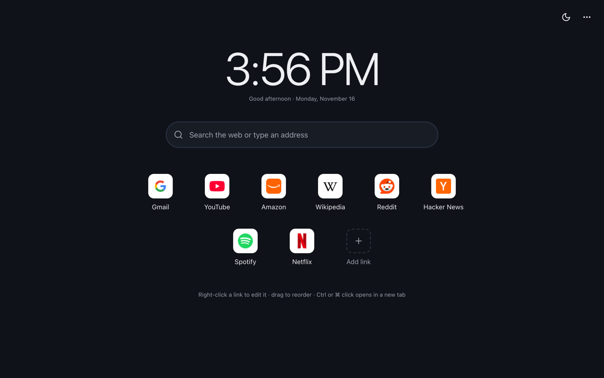

# Home - Clean New Tab

A clean new tab page for Chrome, Edge and Firefox: a big clock, a search box and your favourite sites one click away.
Your links are stored only in your browser. Nothing is sent anywhere.

## Install on Chrome

1. Download `Home.zip` from the [latest release](https://github.com/p32929/Home/releases/latest).
2. Unzip it. You get a folder called `Home`. Keep it somewhere it will stay, like your Documents folder.
3. Open `chrome://extensions` and turn on **Developer mode** (top right).
4. Click **Load unpacked** and pick the `Home` folder. Open a new tab and you are done.

## Update to a new version

1. Download the new `Home.zip` and unzip it over the same `Home` folder, replacing the old files.
2. On `chrome://extensions`, click the reload arrow on the Home card. Your links stay.

To be extra safe, use **Export links** first (see below). If you load the new version from a different folder, Chrome treats it as a new extension with no links, and **Import links** brings them back.

## Install on Edge

Same steps as Chrome, but open `edge://extensions` and turn on **Developer mode** (left side).

## Install on Firefox

1. Open `about:debugging#/runtime/this-firefox`.
2. Click **Load Temporary Add-on** and pick `manifest.json` inside the `Home` folder.

Firefox removes temporary add-ons when it closes, so this is good for trying it out.

## Use it

1. **Add a link:** click the **+ Add link** tile, or click the Home button in the toolbar on any page to add that page.
2. **Edit or delete:** right-click a link, or hover it and click the three dots.
3. **Reorder:** drag a link to a new place. Use the **⋯** menu (top right) to sort by name or by the ones you use most.
4. **Search:** type in the search box and press Enter. An address like `github.com` opens the site; anything else is searched with your browser's search engine.
5. **Theme:** the sun / moon button (top right) switches between light, dark and your system setting.
6. **Back up or move your links:** **⋯** menu, then **Export links** saves a file. **Import links** loads it on any computer.

Links you saved with the old version of Home are moved over by themselves the first time you open a new tab.

## Build it yourself

1. `npm install`
2. `npm run zip` builds the extension into `dist/` and makes `release/Home.zip`.
3. `npm run dev` runs the page in a normal browser tab while you work on it (links are then saved in that tab's local storage).

## License

MIT License — see [LICENSE](LICENSE) for the full text.

## Contributing

Contributions are warmly welcomed and greatly appreciated! Whether it's a bug fix, new feature, or improvement, your input helps make this project better for everyone.

Before submitting a pull request, please:

1. Create an issue describing the feature or bug fix you'd like to work on
2. Wait for discussion and approval to ensure alignment with project goals
3. Fork the repository and create your feature branch
4. Submit your pull request with a clear description of changes

This approach helps avoid duplicate efforts and ensures smooth collaboration. Thank you for considering contributing!

## Share

Sharing this repository with your friends is just one click away from here

